<h1 align="center">Mahdi Habibi, Ph.D.</h1> 
 <b>Data Scientist · AI / ML Engineer · Computational Physicist</b> 
 
 Lead AI developer at DealCircle GmbH · Open-source author (TelescopeML) · Explainable AI (XAI) specialist 
 
      

About

I am a senior data scientist and machine learning engineer with a Ph.D. in computational physics and more than 10 years of experience turning data into reliable, production-grade systems. My work spans the full lifecycle of AI/ML projects, from research and prototyping to deployment, in close collaboration with cross-functional teams.

🔭 Lead developer of recommendation systems and AI applications at DealCircle GmbH.
🧠 Specialist in Explainable AI (XAI), improving the transparency and trustworthiness of black-box models.
📦 Author and maintainer of the open-source Python package TelescopeML, including its XAI module.
🚀 Builder of end-to-end AI / ML / Deep Learning projects across computer vision, generative models, and time-series.
Focus Areas

Explainable AI (XAI) · Deep Learning · Computer Vision · Generative Models · Recommendation Systems · Time-Series Analysis · MLOps & Deployment

Skills & Tools

Languages

Show Image Show Image Show Image Show Image Show Image

ML & Deep Learning

Show Image Show Image Show Image Show Image Show Image

Data & Visualization

Show Image Show Image Show Image Show Image Show Image

Backend & Deployment

Show Image Show Image Show Image Show Image Show Image Show Image Show Image Show Image

🏅 Certifications & Credentials

 <a href="https://www.credly.com/badges/bc43b40a-eef4-4f7a-8f9d-ed97f8b4419e/public_url">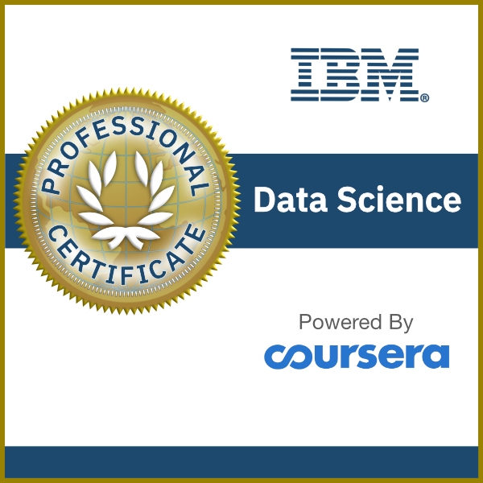</a>    <a href="https://www.coursera.org/account/accomplishments/certificate/EHQQBJXQMLJM">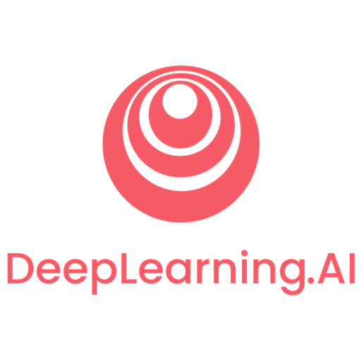</a> 

📂 Featured Projects
Project	Techniques	Data Types	Poster
Knowledge Graphs: Semantic Graphs and Property Graphs
An illustrated, open book with a companion lab: one catalog modeled in two graph worlds, from RDF, OWL, SPARQL and SHACL to Neo4j and Cypher, through architecture and graph RAG. Published on Zenodo (DOI <a href="https://doi.org/10.5281/zenodo.24316420">10.5281/zenodo.24316420</a>).	Knowledge Graphs, RDF/RDFS, OWL, SPARQL, SHACL, Labeled Property Graphs, Neo4j, Cypher, Graph RAG, Provenance	Graph, RDF Triples, Text	<a href="https://github.com/mdhabibi/mdhabibi/blob/main/knowledge-graphs-book.png">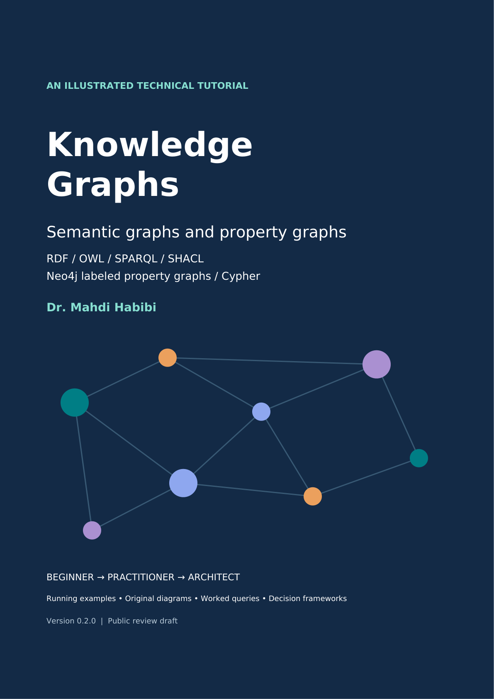</a>
BeatLens — ECG T-Peak Timing Workbench
A research workbench (TimeNet Hackathon 2026) that locates the T-wave peak in two-channel ECG beats from a known R-peak anchor and explains which waveform regions drove the estimate. Live explorer.	Time-Series Language Models (OpenTSLM), LoRA Fine-tuning, Kernel Readout, Temporal LIME, Integrated Gradients, XAI, Streamlit	Timeseries (ECG)	<a href="https://github.com/mdhabibi/mdhabibi/blob/main/beatlens.jpg">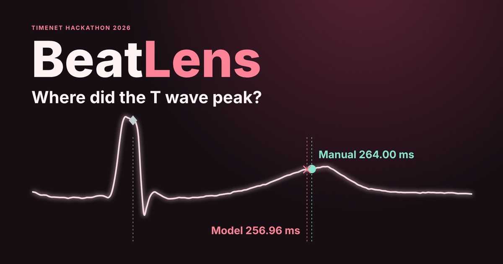</a>
Search Semantically — LLMs & Semantic Search Handbook
A 14-chapter open-source course with runnable notebooks, a free e-book and a docs site: from keyword search to embeddings, dense retrieval, re-ranking, evaluation and RAG.	Embeddings, Dense Retrieval, BM25, Vector Databases & ANN, Re-ranking, RAG, Search Evaluation, MkDocs, CI	Text, Vectors	<a href="https://github.com/mdhabibi/mdhabibi/blob/main/llm-search-handbook.png">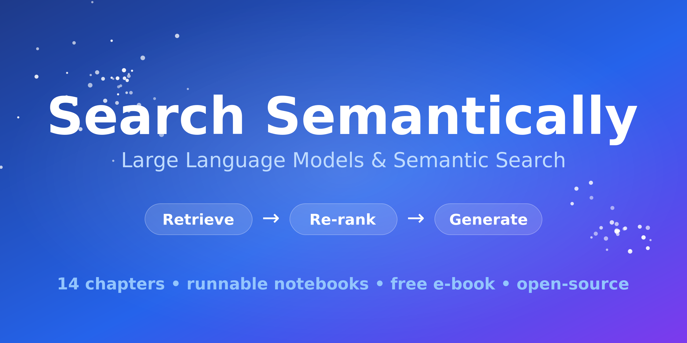</a>
Agentic System Design Tutorial
A step-by-step guide to architecting a production-grade agentic AI system — LLM gateway, orchestrator, sub-agents, tool registry, memory, guardrails and observability.	Agentic AI, LLM Orchestration, Tool Calling, Memory & RAG, Guardrails, Observability, System Design	Text, Architecture Diagrams	<a href="https://github.com/mdhabibi/mdhabibi/blob/main/agentic-system-design.png">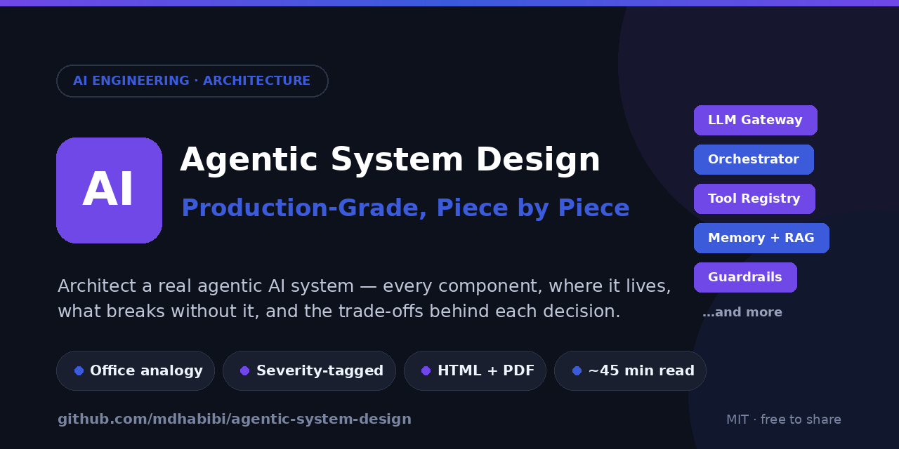</a>
The 12-Factor App — Explained for Beginners
An interactive, single-file tutorial on the 12-Factor methodology with plain-English analogies, Python do/don't examples and hand-drawn diagrams.	Cloud-Native Design, 12-Factor Methodology, Docker, Kubernetes, CI/CD, Software Architecture	—	<a href="https://github.com/mdhabibi/mdhabibi/blob/main/12-factor-app.png">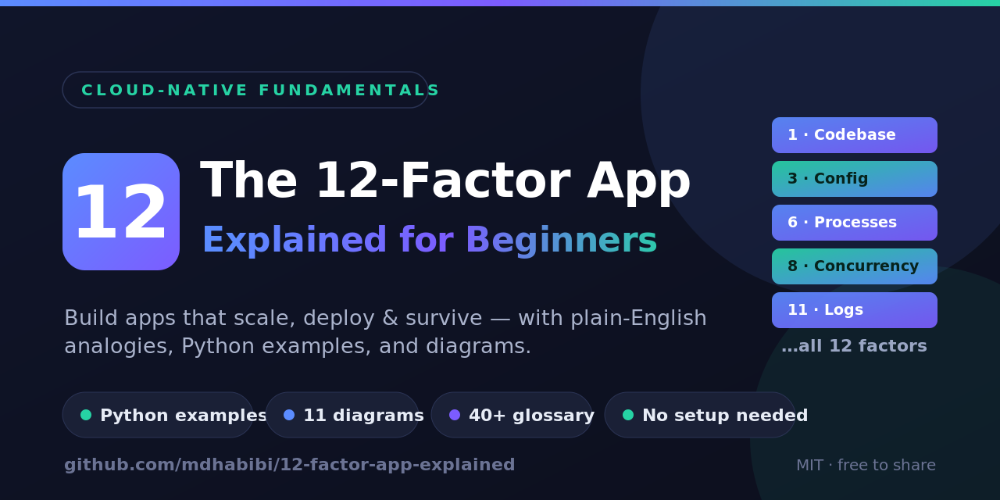</a>
Pub/Sub Best Practices Tutorial
A visual beginner's guide to Google Cloud Pub/Sub best practices — batching, ordering, pull vs. push, dead-letter topics, IAM and testing — with console mockups and Python snippets.	Messaging Systems, Google Cloud Pub/Sub, Event-Driven Architecture, Reliability Patterns, IAM	Streaming Messages, Events	<a href="https://github.com/mdhabibi/mdhabibi/blob/main/pubsub-best-practices.png">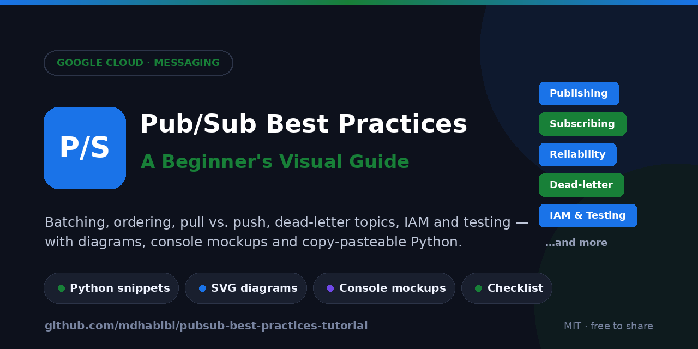</a>
SOLID Design Principles Tutorial
Learn SOLID design principles through interactive Jupyter notebook tutorials.	SOLID principles, design patterns, OOP, software architecture, code quality	—	
TelescopeML — Open-Source Python Package
Deep CNNs and ML models for analyzing stellar and exoplanetary telescope spectra.	Deep CNN, Machine Learning, XAI, Bayesian optimization, Feature Engineering	Timeseries, Tabular	<a href="https://github.com/mdhabibi/mdhabibi/blob/main/TelescopeML.png">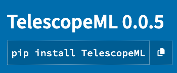</a>
Malaria Cell Classifier
Deep CNNs and ML models for anomaly detection in microscopic malaria cells.	Deep CNN, Data Augmentation, Feature Engineering, Image Processing, Optimization	Image	<a href="https://github.com/mdhabibi/mdhabibi/blob/main/MalariaClassifierArtImage.png">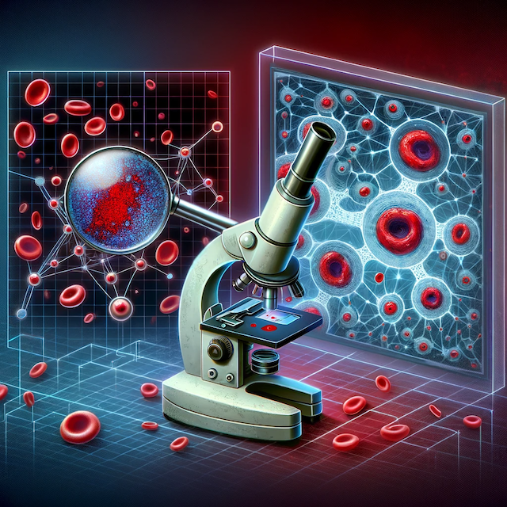</a>
BloodPy — Automated Blood Cell Classifier
Multi-classification of peripheral blood cells using deep CNNs and ML models.	Deep CNN, Data Augmentation, Transfer Learning, U-Net, Image Processing, Statistical Analysis, OpenCV, Fine-tuning	Image, Metadata	
Dataset: Segmented Peripheral Blood Cells (OpenCV)
A dataset of segmented white blood cell images using advanced image processing.	GrabCut, Morphological Operations, OpenCV	Image, Binary Masks, Dataset	
LIME for Macroscopic Medical Images
A surrogate model (LIME) for enhancing transparency of medical diagnostics.	Deep CNN, LIME, XAI, Computer Vision, Optimization	Image	<a href="https://github.com/mdhabibi/mdhabibi/blob/main/LIME.png">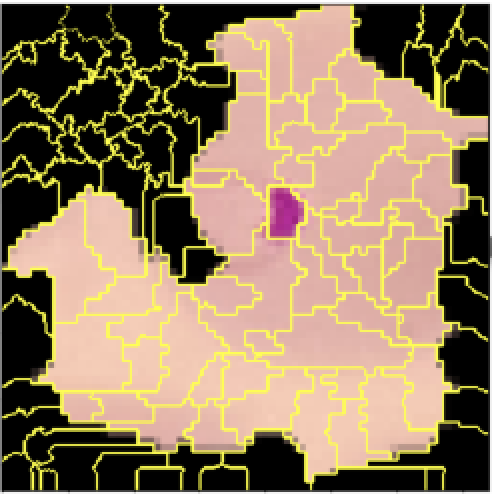</a>
CAM for Macroscopic Medical Images
Class Activation Mapping (CAM) for anomaly localization interpretability.	Deep CNN, CAM, XAI, Computer Vision, Data Analysis, Optimization	Image	<a href="https://github.com/mdhabibi/mdhabibi/blob/main/CAM.png">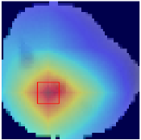</a>
Automated Nucleus Detector
A semantic segmentation solution for automating nucleus detection in biomedical images.	U-Net, Keras-Tuner, Semantic Segmentation	Image	
FastAPI Questionnaire API
A FastAPI application to manage and retrieve questionnaire data with authentication and custom error handling.	FastAPI, Authentication, Data Management, Error Handling, Shell	API, CSV	
Neural Compression
Advanced autoencoder architecture for efficient lossless data compression.	Autoencoder, GenAI, SSIM, PSNR	Image	
LIME for ECG Classification
A surrogate model (LIME) for enhancing transparency of time-series classification.	CNN, LIME, Time Series Analysis	Timeseries	
Beta-Variational Autoencoders
Generative learning (GenAI) with Beta-Variational Autoencoders.	Beta-VAEs, Latent Space Analysis	Image	<a href="https://github.com/mdhabibi/mdhabibi/blob/main/VAEs.png">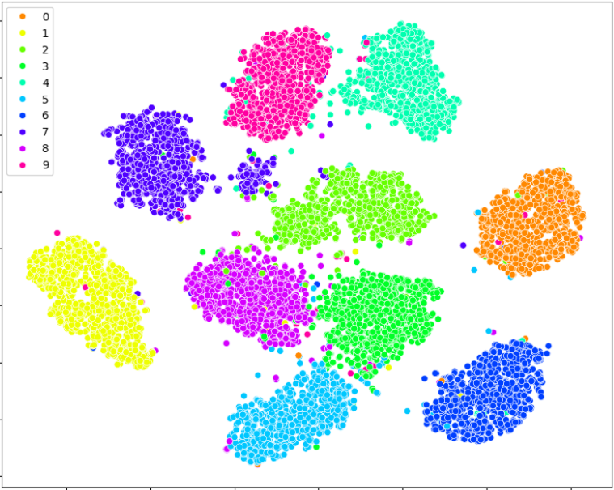</a>
Movie Recommendation Systems
Collaborative filtering, content-based filtering, and Bayesian average techniques.	Collaborative Filtering, Content-Based Filtering, Bayesian Average	Metadata, User Ratings, CSV	
Falcon 9 Rocket Predictor
A data-driven project to predict the success of Falcon 9 rocket landings.	Data Wrangling, Feature Engineering, Web-Scraping, JSON Processing, SQL, Hadoop, Folium, Decision Trees	Unstructured, Tabular, Database	
Variational Autoencoders
A collection of VAE architectures built with the Keras deep learning framework.	Variational Autoencoders, Exploratory Data Analysis	Image	<a href="https://github.com/mdhabibi/mdhabibi/blob/main/AEs.png">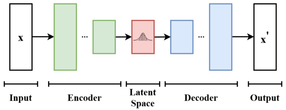</a>
Netflix Content Analysis
Exploratory analysis of Netflix's catalog to uncover trends in content distribution and quality.	Exploratory Data Analysis, Data Visualization, Statistical Analysis	Metadata	<a href="https://github.com/mdhabibi/mdhabibi/blob/main/netflix.jpg">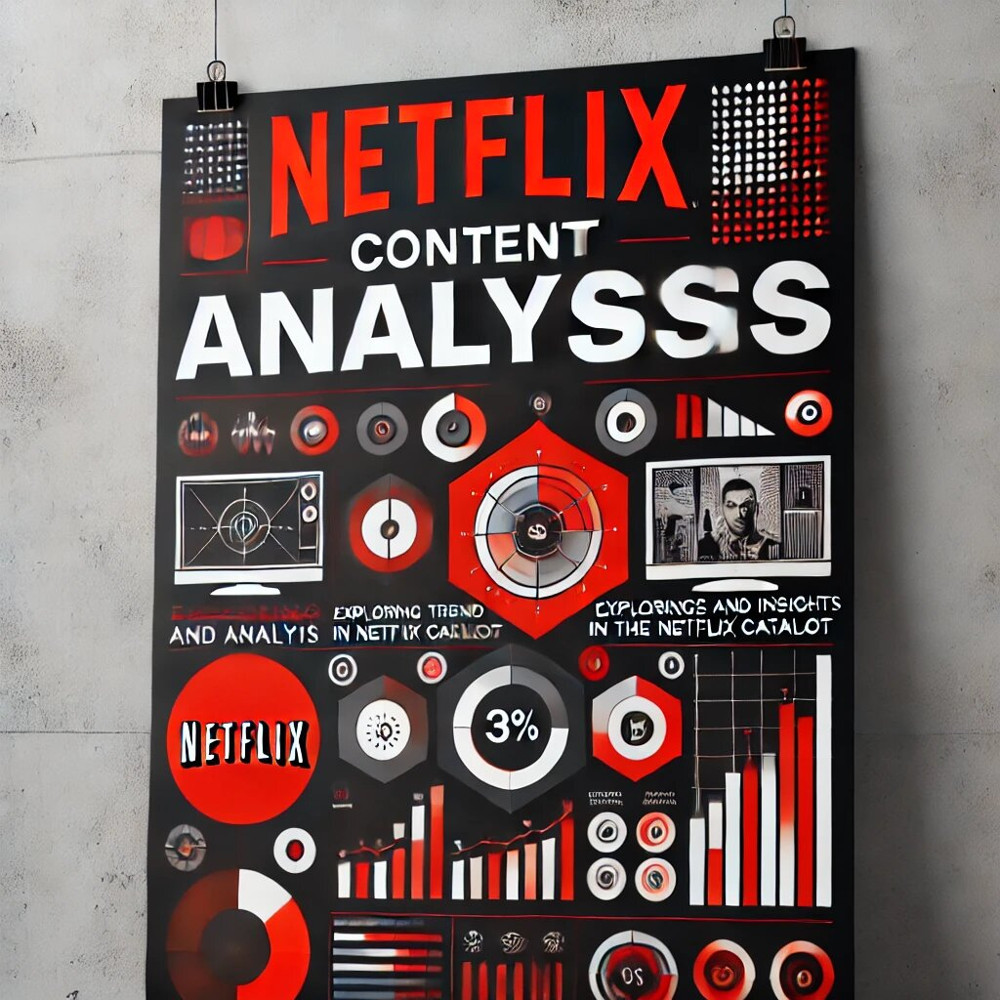</a>
Air Passenger Time-Series Analysis
Exploratory analysis of the Air Passengers dataset, uncovering trends and patterns over time.	Time-Series Analysis, Log Transformation, Moving Averages, Seasonal Decomposition	Timeseries	<a href="https://github.com/mdhabibi/mdhabibi/blob/main/airspace.jpg">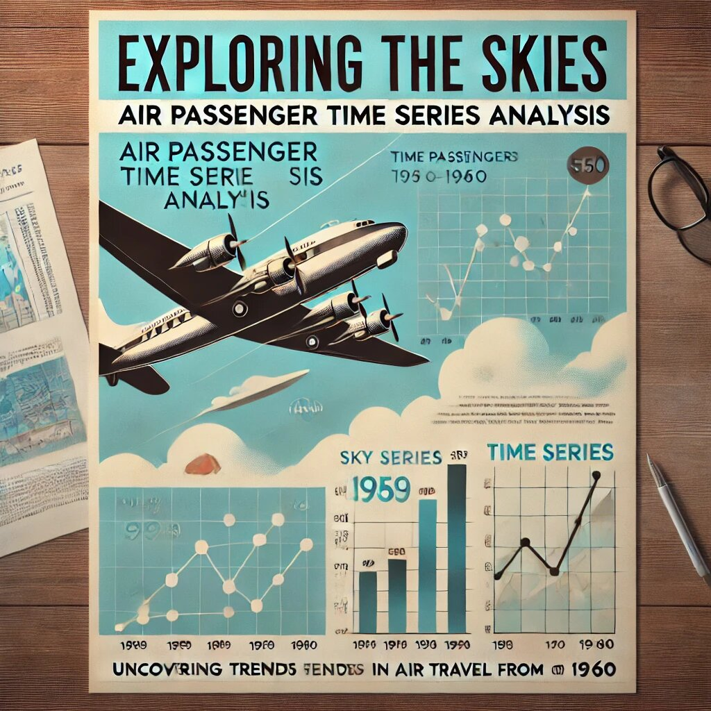</a>

 <i>Open to collaboration on AI, machine learning, and explainable-AI projects. Feel free to reach out.</i> 

